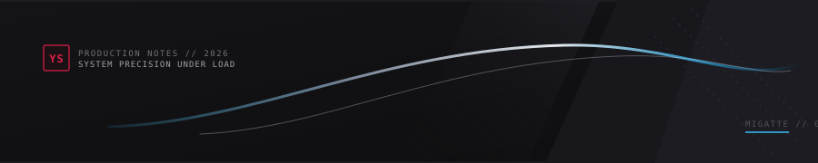
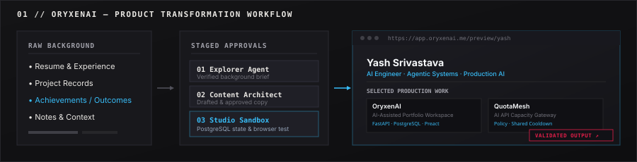
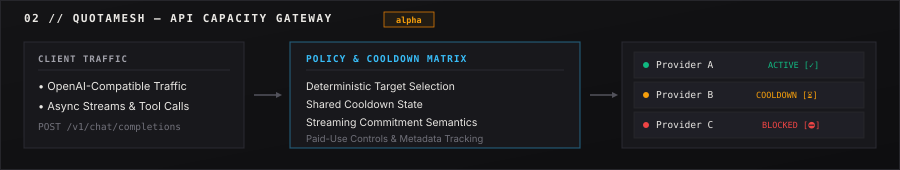
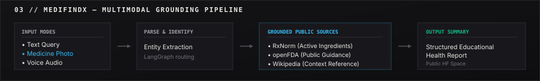

<picture>
  <source media="(prefers-color-scheme: dark)" srcset="./assets/editorial/hero-manga-dark.svg">
  <source media="(prefers-color-scheme: light)" srcset="./assets/editorial/hero-manga-light.svg">
  
</picture>

# Yash Srivastava

Founding AI Engineer @ Xpression &nbsp;·&nbsp; Agentic Systems &nbsp;·&nbsp; Production AI

I build production AI systems around agents, context, memory, tools and reliable backend execution.

[Portfolio ↗](https://yashdev.ai.studio/) &nbsp;·&nbsp; [LinkedIn ↗](https://www.linkedin.com/in/yash-srivastava-bbd) &nbsp;·&nbsp; [GitHub ↗](https://github.com/yashsrivastava0) &nbsp;·&nbsp; [Email ↗](mailto:yashxbbd@gmail.com)

<picture>
  <source media="(prefers-color-scheme: dark)" srcset="./assets/editorial/divider-rule-dark.svg">
  <source media="(prefers-color-scheme: light)" srcset="./assets/editorial/divider-rule-light.svg">
  
</picture>

## Selected Work

<a href="https://github.com/yashsrivastava0/OryxenAI">
  <picture>
    <source media="(prefers-color-scheme: dark)" srcset="./assets/projects/oryxenai-product-dark.svg">
    <source media="(prefers-color-scheme: light)" srcset="./assets/projects/oryxenai-product-light.svg">
    
  </picture>
</a>

### [OryxenAI](https://github.com/yashsrivastava0/OryxenAI)
**AI-assisted portfolio workspace** that turns a person's background, achievements, and supplied context into approved material, reviewable portfolio content, and validated private portfolio versions.

* **Product workflow:** Staged pipeline moving through Explorer Agent → Content Architect → Studio with explicit human-approval gates.
* **Engineering surface:** PostgreSQL-backed session state, durable background worker jobs, structured validation, automated browser verification, and isolated sandboxed previews.
* **Links:** [Repository ↗](https://github.com/yashsrivastava0/OryxenAI) &nbsp;·&nbsp; [Live Workspace ↗](https://app.oryxenai.me/)

 

<a href="https://github.com/yashsrivastava0/QuotaMesh">
  <picture>
    <source media="(prefers-color-scheme: dark)" srcset="./assets/projects/quotamesh-routing-dark.svg">
    <source media="(prefers-color-scheme: light)" srcset="./assets/projects/quotamesh-routing-light.svg">
    
  </picture>
</a>

### [QuotaMesh](https://github.com/yashsrivastava0/QuotaMesh) `alpha`
**Local AI API capacity gateway** for routing authorized OpenAI-compatible traffic across configured provider access with deterministic fallback, shared cooldown state, and explicit paid-use controls.

* **Problem:** Makes provider availability, cooldowns, fallback, and cost policy explicit instead of forcing every consuming application to solve them independently.
* **Engineering:** Deterministic target selection, shared cooldown state, streaming commitment semantics, failure classification, paid-use policy, and durable metadata-only usage/history.
* **Links:** [Repository ↗](https://github.com/yashsrivastava0/QuotaMesh)

 

<a href="https://github.com/yashsrivastava0/MediFindX0">
  <picture>
    <source media="(prefers-color-scheme: dark)" srcset="./assets/projects/medifindx-grounding-dark.svg">
    <source media="(prefers-color-scheme: light)" srcset="./assets/projects/medifindx-grounding-light.svg">
    
  </picture>
</a>

### [MediFindX](https://github.com/yashsrivastava0/MediFindX0)
**Educational multimodal health-information assistant** supporting text, medicine-photo, and voice workflows with grounding from public information sources.

* **Problem:** Educational guidance across multimodal health queries using grounded public sources rather than unverified diagnostic assumptions.
* **Engineering:** Multimodal input handling, public-source retrieval (RxNorm, openFDA, Wikipedia), structured report generation, and public Hugging Face Space deployment.
* **Links:** [Repository ↗](https://github.com/yashsrivastava0/MediFindX0) &nbsp;·&nbsp; [Live Hugging Face Space ↗](https://huggingface.co/spaces/PromptYASH/Medifindx)

 

## Production Experience

**Xpression — Founding AI Engineer** &nbsp;·&nbsp; `Oct 2025 → Present`  
* Architecting an AI SDLC platform; owning delivery on a 6-person team.
* Engineered multi-agent orchestration, checkpointed state recovery, relationship-aware context, and FastAPI/PostgreSQL workers.

**JUTEQ Inc — AI Engineer** &nbsp;·&nbsp; `Jul 2025 → Oct 2025`  
* Built client-facing conversational automation, browser-driven workflows, and dealership booking integrations.

**IIT Mandi — Backend Developer Intern & Researcher** &nbsp;·&nbsp; `Jan 2024 → Jun 2024`  
* Developed sensor-data architecture and PostgreSQL validation backend for real-time IoT monitoring (HIMCOSTE).

 

<picture>
  <source media="(prefers-color-scheme: dark)" srcset="./assets/editorial/divider-rule-dark.svg">
  <source media="(prefers-color-scheme: light)" srcset="./assets/editorial/divider-rule-light.svg">
  
</picture>

## Engineering Surface

* **Agentic Systems:** Multi-agent orchestration, dynamic DAG scheduling, checkpointed state machines, bounded retries.
* **Context & Memory:** Relationship-aware context assembly, token pruning (~33% ↓), long-horizon memory, structured outputs.
* **RAG / MCP / Tools:** Model Context Protocol (MCP), tool sandboxing, public-source retrieval, policy guardrails.
* **Python & FastAPI:** Asynchronous execution (`asyncio`), high-concurrency APIs, Pydantic validation, schema serialization.
* **PostgreSQL & Async Workflows:** Durable session state, worker queues, relational schemas, Redis caching.
* **Reliability & Validation:** Failure classification, shared cooldown states, automated AST verification, deterministic recovery.
* **Platform & Delivery:** Docker, GitHub Actions, AWS, automated browser testing, production operations.

 

<picture>
  <source media="(prefers-color-scheme: dark)" srcset="./assets/editorial/divider-rule-dark.svg">
  <source media="(prefers-color-scheme: light)" srcset="./assets/editorial/divider-rule-light.svg">
  
</picture>

## Open Source — Next

Increasing upstream work around AI developer tooling, MCP, agent orchestration, and Python infrastructure. Merged public contributions will be linked here.

 

<strong>Calm Under Load — Systems Philosophy</strong>

 

In distributed AI systems, external models timeout, rate limits occur, and context windows overflow. 

The visual language of this profile draws on the discipline of **Ultra Instinct** and **manga ink composition**:
* **Calm Under Load:** When dependencies fail, the system reacts deterministically rather than crashing.
* **Disciplined Precision:** Every tool call is bounded, state is checkpointed, and noise is systematically pruned.
* **Deterministic Recovery:** Absolute poise and fluid recovery under peak operational load.

 

---

Yash Srivastava &nbsp;·&nbsp; Founding AI Engineer &nbsp;·&nbsp; [Portfolio ↗](https://yashdev.ai.studio/) &nbsp;·&nbsp; [LinkedIn ↗](https://www.linkedin.com/in/yash-srivastava-bbd) &nbsp;·&nbsp; [GitHub ↗](https://github.com/yashsrivastava0) &nbsp;·&nbsp; [Email ↗](mailto:yashxbbd@gmail.com)
