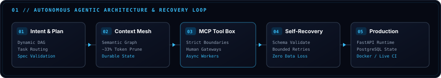
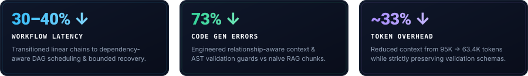
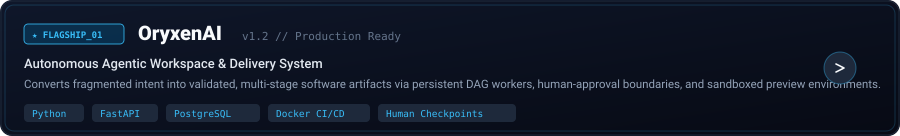
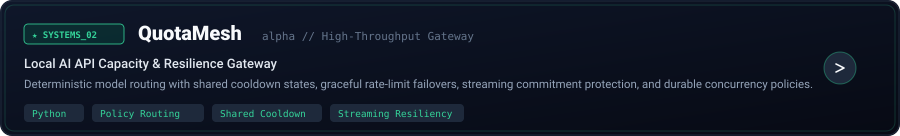
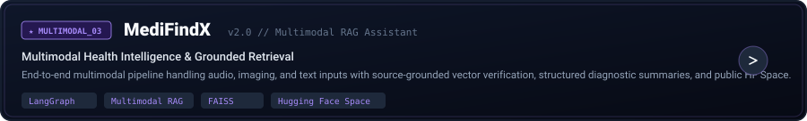
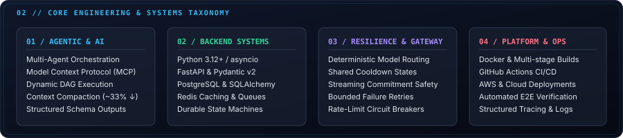
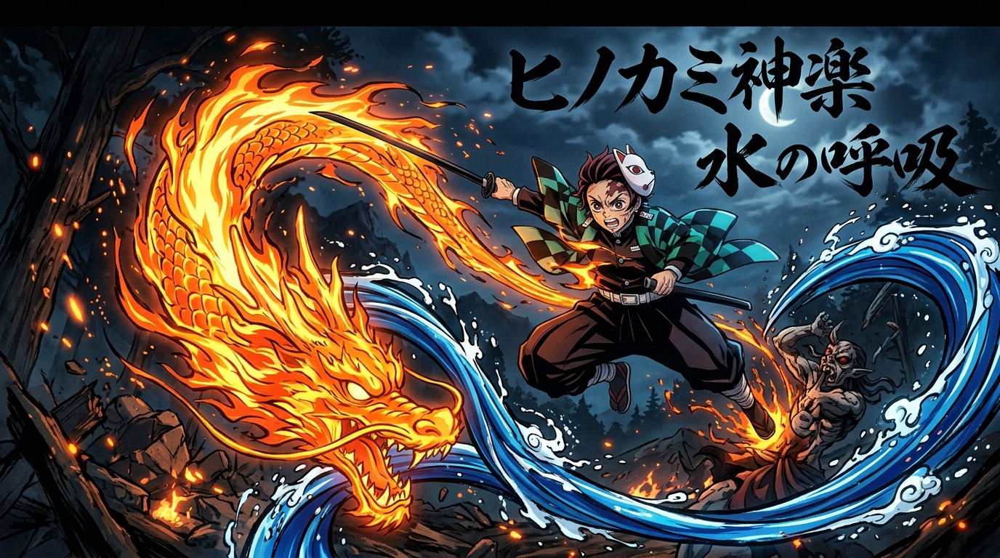

<!--
╔══════════════════════════════════════════════════════════════════════════════════╗
║  YASH SRIVASTAVA // RECRUITER-FIRST AGENTIC AI & SYSTEMS PROFILE                 ║
║  Visual System: Migatte // Systems (Ultra Instinct Precision × Editorial Eng)   ║
║  Assets: 100% Native Local SVGs with Dark/Light Adaptive <picture> Support      ║
╚══════════════════════════════════════════════════════════════════════════════════╝
-->

<picture>
  <source media="(prefers-color-scheme: dark)" srcset="./assets/hero/hero-dark.svg">
  <source media="(prefers-color-scheme: light)" srcset="./assets/hero/hero-light.svg">
  
</picture>

 

  
  &nbsp;&nbsp;
  
  &nbsp;&nbsp;
  
  &nbsp;&nbsp;
  

  <code>FOUNDING AI ENGINEER @ XPRESSION</code>
  &nbsp;·&nbsp;
  <code>AGENTIC SYSTEMS ARCHITECT</code>
  &nbsp;·&nbsp;
  <code>GLOBAL REMOTE</code>

  <em>Architecting production AI systems beyond the model call — state-durable DAG orchestration, context compaction, bounded tool calling, and resilient infrastructure.</em>

## 01 // ARCHITECTURAL BLUEPRINT

I work at the layer between **model capability and production reliability**. 

Real-world AI systems fail when treated as single prompt-response calls. My work focuses on deterministic execution, bounded side effects, and state survival when distributed components degrade:

<picture>
  <source media="(prefers-color-scheme: dark)" srcset="./assets/architecture/agentic-architecture-dark.svg">
  <source media="(prefers-color-scheme: light)" srcset="./assets/architecture/agentic-architecture-light.svg">
  
</picture>

 

* **Dynamic DAG Decomposition:** Task decomposition with dependency-aware scheduling rather than brittle sequential chains.
* **Relationship-Aware Context:** Context assembly that indexes code dependencies, constraints, and prior decisions, pruning noise by ~33%.
* **Strict Tool Sandboxing (MCP):** Bounded execution boundaries where external tools and APIs operate within least-privilege policies.
* **Deterministic Self-Recovery:** Structured Pydantic schema validation, automated AST verification, and checkpointed rollback states.
* **Production Systems Runtime:** High-throughput FastAPI workers backed by PostgreSQL persistence, Redis queues, and Docker containerization.

 

## 02 // MEASURED SYSTEMS IMPACT

Verified outcomes from production and architectural benchmarks:

<picture>
  <source media="(prefers-color-scheme: dark)" srcset="./assets/impact/impact-dark.svg">
  <source media="(prefers-color-scheme: light)" srcset="./assets/impact/impact-light.svg">
  
</picture>

 

* **30–40% ↓ Workflow Latency:** Migrated AI workflows from linear execution to dependency-aware DAG scheduling with parallel async workers and bounded retry boundaries.
* **73% ↓ Generation Failures:** Replaced naive chunk-retrieval RAG with relationship-aware context graphs and schema verification gates in production workloads.
* **~33% ↓ Representative Token Footprint:** Reduced long-horizon workflow context from ~95K to 63.4K tokens while strictly enforcing authorization, permission, and schema constraints.

---

## 03 // FLAGSHIP SYSTEMS

Curated production codebases and systems illustrating architectural depth:

<a href="https://github.com/yashsrivastava0/OryxenAI">
  <picture>
    <source media="(prefers-color-scheme: dark)" srcset="./assets/projects/oryxenai-dark.svg">
    <source media="(prefers-color-scheme: light)" srcset="./assets/projects/oryxenai-light.svg">
    
  </picture>
</a>

### [OryxenAI](https://github.com/yashsrivastava0/OryxenAI)
**Autonomous Agentic Workspace & Delivery System**
* **Core Problem:** Transforms fragmented, unstructured engineering inputs into validated, multi-stage software artifacts with full revision history.
* **Architecture:** Staged agentic workflow with explicit human-approval gates, durable PostgreSQL session checkpoints, isolated sandboxed preview environments, and automated browser verification.
* **Stack:** `Python` · `FastAPI` · `PostgreSQL` · `SQLAlchemy` · `TypeScript` · `Vite` · `Docker CI/CD`
* **Links:** [Repository ↗](https://github.com/yashsrivastava0/OryxenAI) &nbsp;·&nbsp; [Live Workspace ↗](https://app.oryxenai.me/)

 

<a href="https://github.com/yashsrivastava0/QuotaMesh">
  <picture>
    <source media="(prefers-color-scheme: dark)" srcset="./assets/projects/quotamesh-dark.svg">
    <source media="(prefers-color-scheme: light)" srcset="./assets/projects/quotamesh-light.svg">
    
  </picture>
</a>

### [QuotaMesh](https://github.com/yashsrivastava0/QuotaMesh) `alpha`
**Local AI API Capacity & Resilience Gateway**
* **Core Problem:** Prevents downstream agent failures caused by provider rate limits, token exhaustion, and abrupt streaming interruptions.
* **Architecture:** Deterministic routing matrix with shared cross-worker cooldown states, streaming commitment protection, and local request replay history.
* **Stack:** `Python 3.12` · `FastAPI` · `asyncio` · `Policy Routing` · `Circuit Breakers`
* **Links:** [Repository ↗](https://github.com/yashsrivastava0/QuotaMesh)

 

<a href="https://github.com/yashsrivastava0/MediFindX0">
  <picture>
    <source media="(prefers-color-scheme: dark)" srcset="./assets/projects/medifindx-dark.svg">
    <source media="(prefers-color-scheme: light)" srcset="./assets/projects/medifindx-light.svg">
    
  </picture>
</a>

### [MediFindX](https://github.com/yashsrivastava0/MediFindX0)
**Multimodal Health Intelligence & Grounded Retrieval**
* **Core Problem:** Grounded, hallucination-resistant clinical intelligence across audio, imaging, and clinical text inputs.
* **Architecture:** Multi-agent pipeline with LangGraph orchestration, FAISS vector indexing, source validation backstops, and public deployment on Hugging Face Spaces.
* **Stack:** `LangGraph` · `LangChain` · `FAISS` · `FastAPI` · `Gradio`
* **Links:** [Repository ↗](https://github.com/yashsrivastava0/MediFindX0) &nbsp;·&nbsp; [Live Hugging Face Space ↗](https://huggingface.co/spaces/PromptYASH/Medifindx)

---

## 04 // PROFESSIONAL EXPERIENCE

### **Founding AI Engineer** — Xpression
`Oct 2025 → Present` &nbsp;·&nbsp; *Architecture & Production Delivery*
* Architecting the core autonomous SDLC platform converting complex product specs into deployed full-stack microservices.
* Own the multi-agent orchestration engine, dependency scheduling, checkpointed state machines, and partial-failure recovery.
* Designed relationship-aware context assembly reducing token consumption by ~33% and eliminating 73% of generation failures.
* Work directly with founders on a 6-person engineering team, leading system design and technical hiring.

 

### **AI Engineer** — JUTEQ Inc
`Jul 2025 → Oct 2025` &nbsp;·&nbsp; *Client-Facing AI & Automation*
* Owned end-to-end AI workflows for automotive dealerships, managing stakeholder requirements through production rollouts.
* Built resilient browser automation, appointment scheduling agents, and authentication gateways with zero downtime.

 

### **Backend Developer Intern & Researcher** — Indian Institute of Technology, Mandi
`Jan 2024 → Jun 2024` &nbsp;·&nbsp; *Distributed Sensor Systems*
* Contributed to the HIMCOSTE-sponsored Smart Blood, Vaccine & Medicine Monitoring System.
* Architected high-throughput PostgreSQL schemas and ingestion microservices processing real-time sensor streams from Arduino and ESP32 hardware.

---

## 05 // CORE SYSTEMS TAXONOMY

<picture>
  <source media="(prefers-color-scheme: dark)" srcset="./assets/stack/core-stack-dark.svg">
  <source media="(prefers-color-scheme: light)" srcset="./assets/stack/core-stack-light.svg">
  
</picture>

 

| Domain | Core Stack & Technologies | Focus & Architectural Ownership |
| :--- | :--- | :--- |
| **Agentic & AI** | LangGraph, MCP, LangChain, FAISS, Pydantic | Multi-agent DAGs, Context Compaction, Model Routing, Structured Schemas |
| **Backend & Distributed** | Python 3.12+, FastAPI, asyncio, SQLAlchemy, Redis | High-concurrency APIs, Durable State Machines, Background Workers |
| **Data & Storage** | PostgreSQL, Redis, Vector Embeddings | ACID guarantees, Event logging, Shared cooldown buffers |
| **Delivery & Infra** | Docker, GitHub Actions, AWS, Linux, Playwright | Containerized workflows, Automated CI/CD verification, Cloud deployment |

---

## 06 // OPEN-SOURCE & UPSTREAM FOCUS (2026)

Active engineering focus on upstream contributions across the Python AI, tool orchestration, and systems ecosystem:

| Target Ecosystem | Focus Area | Planned / Active Contributions | Status |
| :--- | :--- | :--- | :---: |
| **FastAPI / Pydantic** | API Serialization & Gateways | Memory-efficient streaming handlers & schema validation | `Active` |
| **Model Context Protocol (MCP)** | Developer Tooling & Integrations | Standardized tool-bounding wrappers & auth middleware | `In Progress` |
| **Agent Runtimes (LangGraph / CrewAI)** | State Resiliency & Recovery | Checkpointed task failure handlers & DAG recovery | `Targeted` |
| **Local Inference Gateways** | API Resilience | Shared rate-limit state coordination (QuotaMesh upstream) | `Active` |

> *Contributions are tracked against verifiable PRs and merged changes, emphasizing production utility over vanity metrics.*

---

<strong>07 // MIGATTE SYSTEM — Philosophy & Visual Origin (Click to expand)</strong>

 

  

 

### The Principle: Calm Under Load (身勝手の極意)
In high-stress distributed systems, things inevitably break: rate limits get hit, external models timeout, and context windows overflow. 

The visual theme of this profile is inspired by **Mastered Ultra Instinct** and **Demon Slayer**:
* **Zero Panic:** When a model fails or a worker crashes, the system does not fail abruptly — it reacts deterministically.
* **Disciplined Precision:** Every tool call is bounded; every piece of state is checkpointed; every context token is justified.
* **Absolute Recovery:** Like sword and breath discipline (*全集中*), the architecture maintains fluid execution under peak load.

 

  

---

### Build for the happy path. Engineer for everything after it.

**AI Systems · Durable Backends · Autonomous Agents**

 

  
  &nbsp;&nbsp;
  
  &nbsp;&nbsp;
  

Yash Srivastava · Founding AI Engineer · Worldwide Remote Available

