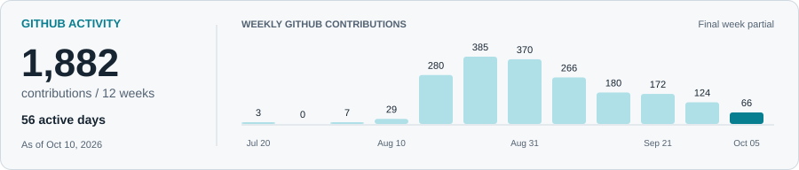

<picture>
  <source media="(prefers-reduced-motion: reduce) and (max-width: 600px)" srcset="./assets/profile/hero-mobile-static.svg" />
  <source media="(prefers-reduced-motion: reduce)" srcset="./assets/profile/hero-static.svg" />
  <source media="(max-width: 600px)" srcset="./assets/profile/hero-mobile.svg" />
  
</picture>

# AI Engineer. Building agentic systems.

I'm **Yash**, a **Founding AI Engineer at Xpression**, based in India.

I build agents that use tools, keep context, and recover when a workflow fails. I work on the Python backends behind them and take projects from an idea through implementation and deployment.

I'm looking for **remote AI engineering roles with teams in the US and Europe**.

[Portfolio](https://yashdev.ai.studio/) · [LinkedIn](https://www.linkedin.com/in/yash-srivastava-bbd) · [Email](mailto:yashxbbd@gmail.com)

## Selected work

<a href="https://github.com/yashsrivastava0/OryxenAI">
  <picture>
    <source media="(prefers-reduced-motion: reduce) and (max-width: 600px) and (prefers-color-scheme: dark)" srcset="./assets/profile/oryxenai-mobile-dark-static.svg" />
    <source media="(prefers-reduced-motion: reduce) and (max-width: 600px)" srcset="./assets/profile/oryxenai-mobile-light-static.svg" />
    <source media="(prefers-reduced-motion: reduce) and (prefers-color-scheme: dark)" srcset="./assets/profile/oryxenai-dark-static.svg" />
    <source media="(prefers-reduced-motion: reduce)" srcset="./assets/profile/oryxenai-light-static.svg" />
    <source media="(max-width: 600px) and (prefers-color-scheme: dark)" srcset="./assets/profile/oryxenai-mobile-dark.svg" />
    <source media="(max-width: 600px)" srcset="./assets/profile/oryxenai-mobile-light.svg" />
    <source media="(prefers-color-scheme: dark)" srcset="./assets/profile/oryxenai-dark.svg" />
    
  </picture>
</a>

Bring your background and project notes, review the proposed copy, then refine a private portfolio. I built the approval steps, saved state, worker jobs, and browser checks behind that flow.

[Code](https://github.com/yashsrivastava0/OryxenAI) · [Open the workspace](https://app.oryxenai.me/)

<a href="https://github.com/yashsrivastava0/QuotaMesh">
  <picture>
    <source media="(prefers-reduced-motion: reduce) and (max-width: 600px) and (prefers-color-scheme: dark)" srcset="./assets/profile/quotamesh-mobile-dark-static.svg" />
    <source media="(prefers-reduced-motion: reduce) and (max-width: 600px)" srcset="./assets/profile/quotamesh-mobile-light-static.svg" />
    <source media="(prefers-reduced-motion: reduce) and (prefers-color-scheme: dark)" srcset="./assets/profile/quotamesh-dark-static.svg" />
    <source media="(prefers-reduced-motion: reduce)" srcset="./assets/profile/quotamesh-light-static.svg" />
    <source media="(max-width: 600px) and (prefers-color-scheme: dark)" srcset="./assets/profile/quotamesh-mobile-dark.svg" />
    <source media="(max-width: 600px)" srcset="./assets/profile/quotamesh-mobile-light.svg" />
    <source media="(prefers-color-scheme: dark)" srcset="./assets/profile/quotamesh-dark.svg" />
    
  </picture>
</a>

One local endpoint for API access you already have. You choose the route and paid-use rules; QuotaMesh handles fallback and shared cooldowns. The **v0.1 MVP** also keeps a local usage history.

[Code](https://github.com/yashsrivastava0/QuotaMesh) · [Try the no-key demo](https://github.com/yashsrivastava0/QuotaMesh#test-without-api-keys)

<picture>
  <source media="(prefers-reduced-motion: reduce) and (max-width: 600px) and (prefers-color-scheme: dark)" srcset="./assets/profile/receptionist-mobile-dark-static.svg" />
  <source media="(prefers-reduced-motion: reduce) and (max-width: 600px)" srcset="./assets/profile/receptionist-mobile-light-static.svg" />
  <source media="(prefers-reduced-motion: reduce) and (prefers-color-scheme: dark)" srcset="./assets/profile/receptionist-dark-static.svg" />
  <source media="(prefers-reduced-motion: reduce)" srcset="./assets/profile/receptionist-light-static.svg" />
  <source media="(max-width: 600px) and (prefers-color-scheme: dark)" srcset="./assets/profile/receptionist-mobile-dark.svg" />
  <source media="(max-width: 600px)" srcset="./assets/profile/receptionist-mobile-light.svg" />
  <source media="(prefers-color-scheme: dark)" srcset="./assets/profile/receptionist-dark.svg" />
  
</picture>

An AI receptionist for HVAC intake and scheduling. I'm building it **with a team**, using Gemini Live, FastAPI, tool calls, and Google Calendar. We're working on real-time audio, safety checks, and reliable booking.

**Team project, in development.** [Ask about the project](mailto:yashxbbd@gmail.com?subject=AI%20Receptionist)

## What I work with

**LLMs and agents:** GPT workflows, RAG, memory, MCP, and tool execution. 
**Backend:** Python, FastAPI, PostgreSQL, Redis, and async workers. 
**Delivery:** Docker, AWS, and automated browser checks.

  
  
  
  
  
  

<strong>A little more about my work</strong>

At **Xpression**, I work on AI SDLC systems in a six-person team: agent orchestration, checkpointed recovery, relationship-aware context, and FastAPI/PostgreSQL workers.

Previously, I built conversational automation and browser workflows at **JUTEQ**, and sensor-data architecture with a PostgreSQL validation backend at **IIT Mandi**.

## Recent GitHub activity

<a href="https://github.com/yashsrivastava0?tab=overview">
  <picture>
    <source media="(max-width: 600px) and (prefers-color-scheme: dark)" srcset="./assets/profile/activity-mobile-dark.svg" />
    <source media="(max-width: 600px)" srcset="./assets/profile/activity-mobile-light.svg" />
    <source media="(prefers-color-scheme: dark)" srcset="./assets/profile/activity-dark.svg" />
    
  </picture>
</a>

[Contribution history](https://github.com/yashsrivastava0?tab=overview) · [Public pull requests](https://github.com/search?q=is%3Apr+author%3Ayashsrivastava0+is%3Apublic&type=pullrequests)

I'm planning more upstream work in MCP tooling and Python infrastructure. I'll link merged contributions here.

<picture>
  <source media="(prefers-reduced-motion: reduce) and (max-width: 600px)" srcset="./assets/profile/after-hours-mobile-static.svg" />
  <source media="(prefers-reduced-motion: reduce)" srcset="./assets/profile/after-hours-static.svg" />
  <source media="(max-width: 600px)" srcset="./assets/profile/after-hours-mobile.svg" />
  
</picture>

Outside work: anime and a growing list of side-project ideas.

---

**For roles, projects, or a conversation about the work: [email me](mailto:yashxbbd@gmail.com).** 
[Portfolio](https://yashdev.ai.studio/) · [LinkedIn](https://www.linkedin.com/in/yash-srivastava-bbd)
