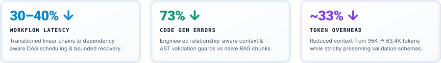
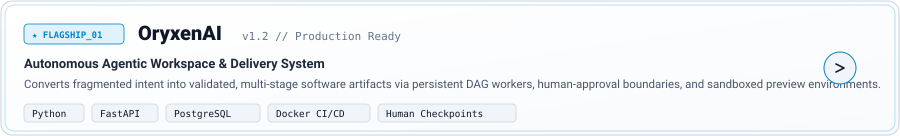
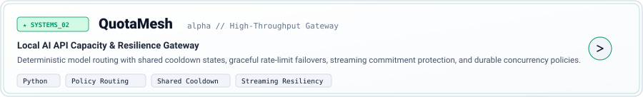
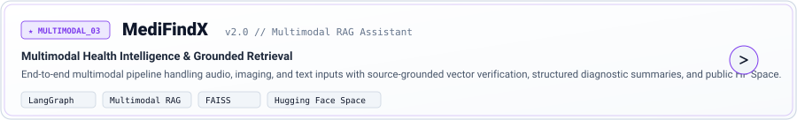

Yes — the previous version was too conservative for what you want. I used Exa to review **40 sources across four research angles**, then cross-checked GitHub’s current documentation, active anime-style profiles, SVG/metrics tooling, your new résumé, and the two audits.

The better direction is **not “professional README + a random anime GIF.”** It should look deliberately art-directed: **Ultra Instinct × editorial engineering** — actual Goku as the primary character cue, Demon Slayer as a secondary visual/easter egg, silver/cyan energy, near-black ink, structured typography, and your real production experience immediately visible.

GitHub explicitly allows images and GIFs in profile READMEs, and its `<picture>` support lets us serve different hero artwork for dark and light mode. GitHub’s job-search guidance still says the substance must be obvious quickly: professional background, skills, experience, best work, and roughly 3–5 deliberately selected repositories. [GitHub Docs](https://docs.github.com/en/get-started/writing-on-github/getting-started-with-writing-and-formatting-on-github/quickstart-for-writing-on-github?apiVersion=2022-11-28\&utm_source=chatgpt.com)

There is already a large ecosystem of anime profile READMEs; the major curated showcase even has a dedicated **Anime** category. The strongest lesson from examples such as the Fate/stay-night-inspired profile is not “add everything”—it is that the anime visual establishes personality while the engineering information remains structured. [GitHub](https://github.com/abhisheknaiidu/awesome-github-profile-readme?utm_source=chatgpt.com)

Your résumé gives us much stronger material than the previous version used: you are currently **Founding AI Engineer at Xpression**, own architecture-to-production delivery on a six-person team, and have concrete production impact around orchestration, context engineering and reliability. Yash_Srivastava_Resume Before that you were an AI Engineer at JUTEQ and a Backend Developer Intern/Researcher at IIT Mandi. Yash_Srivastava_Resume That professional experience should appear **before a generic skill wall**.

Your core public engineering evidence should still be OryxenAI and QuotaMesh: the audit scores them **25/25 and 24/25** respectively. 02-projects-and-public-presence… I'm deliberately **not putting “Voice AI” in your headline/bio**, per your instruction.

# The new direction

I would name the visual concept:

## **MIGATTE // SYSTEMS**
**Ultra Instinct × Production Engineering**

Not because we plaster Japanese text everywhere, but because the theme is:

**calm under load → precision → reaction → recovery → control**

That actually maps naturally to what you build: durable workflows, bounded retries, context control, model routing, state, recovery and production systems.

For the actual anime treatment, I would use **Goku Ultra Instinct once, prominently**. The official Dragon Ball material emphasizes the aura and a calmer, more serious brush-like depiction of Ultra Instinct, which fits this art direction unusually well. [DRAGON BALL OFFICIAL SITE](https://en.dragon-ball-official.com/news/01_2358.html?utm_source=chatgpt.com)

For Demon Slayer, use **one secondary horizontal strip or collapsed “anime mode” area**, not another giant hero. There is plenty of official character imagery to use as visual reference. [Demon Slayer Official Site](https://kimetsu.com/anime/risshihen/character/?chara=tanjiro\&utm_source=chatgpt.com)

I would **not add Yusuke/a third franchise in V1**. Goku + Demon Slayer is already the upper professional limit. Three or four franchises starts reading as an anime fan page rather than an AI engineer's public engineering surface.

---

# Your finished advanced profile README

This is much closer to what I would actually ship.

<!--
╔══════════════════════════════════════════════════════════════════════╗
║  YASH SRIVASTAVA // GITHUB PROFILE                                 ║
║  Visual system: Ultra Instinct × Editorial Engineering             ║
║  Keep assets inside this repository.                               ║
╚══════════════════════════════════════════════════════════════════════╝
-->

<picture>
  <source media="(prefers-color-scheme: dark)" srcset="./assets/hero/hero-dark.svg">
  <source media="(prefers-color-scheme: light)" srcset="./assets/hero/hero-light.svg">
  
</picture>

<br />

<h1 align="center">Yash Srivastava</h1>

<p align="center">
  <strong>AI Engineer · Agentic AI · GenAI Platforms · Production Systems</strong>
</p>

<p align="center">
  <code>Founding AI Engineer @ Xpression</code>
  &nbsp;·&nbsp;
  <code>Python / FastAPI / PostgreSQL</code>
  &nbsp;·&nbsp;
  <code>India → Global</code>
</p>

<p align="center">
  I architect and ship AI systems that go beyond the model call —
  <strong>orchestration, context, memory, tools, state, reliability and production delivery.</strong>
</p>

<p align="center">
  <a href="https://yashdev.ai.studio/">
    
  </a>
  &nbsp;&nbsp;
  <a href="https://www.linkedin.com/in/yash-srivastava-bbd">
    
  </a>
  &nbsp;&nbsp;
  <a href="https://github.com/yashsrivastava0">
    
  </a>
  &nbsp;&nbsp;
  <a href="mailto:yashxbbd@gmail.com">
    
  </a>
</p>

<br />

<p align="center">
  <code>SYSTEM // PRODUCTION AI</code>
  &nbsp;&nbsp;
  <code>MODE // BUILD → TEST → RECOVER → SHIP</code>
  &nbsp;&nbsp;
  <code>NEXT // OPEN SOURCE ↑</code>
</p>

<br />


## 01 // ENGINEERING PROFILE

I work at the layer between **model capability and production reliability**.

My systems combine multi-agent orchestration, relationship-aware context, long-horizon memory, RAG, MCP/tool interfaces, model routing, asynchronous execution and backend reliability.

The part I care about most is what happens when things stop being ideal:

- state has to survive;
- tools have to stay bounded;
- outputs have to be validated;
- failed work has to recover safely;
- context has to remain useful as workflows grow;
- and the system still has to be operable after deployment.

Currently, I work as a **Founding AI Engineer at Xpression**, owning architecture-to-production delivery and working across AI orchestration, backend infrastructure, validation, deployment and engineering decisions.

<br />

<picture>
  <source media="(prefers-color-scheme: dark)" srcset="./assets/impact/impact-dark.svg">
  <source media="(prefers-color-scheme: light)" srcset="./assets/impact/impact-light.svg">
  
</picture>

<br />

### Selected production impact

**30–40% ↓ estimated workflow time**  
Moved AI workflows from a primarily linear execution model toward dependency-aware scheduling, parallel execution and bounded recovery.

**73% ↓ code-generation errors**  
Built relationship-aware context assembly around requirements, dependencies, prior decisions and generated artifacts, measured against the earlier RAG approach in production testing.

**~33% ↓ representative context size**  
Reduced long-horizon workflow context from roughly 95K to 63.4K tokens while retaining important authentication, validation, permission and compliance constraints.

---

## 02 // PRODUCTION EXPERIENCE

### Xpression — Founding AI Engineer
`Oct 2025 → Present`

Architecting an AI-powered SDLC platform that turns a product idea into a deployed full-stack application.

**What I own / work across**

`multi-agent orchestration`
`dependency scheduling`
`parallel execution`
`persistent state`
`approval checkpoints`
`bounded retries`
`partial-failure recovery`

`context engineering`
`long-horizon memory`
`model routing`
`structured outputs`
`MCP + tool interfaces`

`FastAPI`
`PostgreSQL workers`
`real-time events`
`artifact versioning`
`container testing`
`deployment`

I own architecture-to-production delivery on a six-person team, work directly with founders, and participate in engineering interviews.

<br />

### JUTEQ Inc — AI Engineer
`Jul 2025 → Oct 2025`

Owned client-facing AI delivery for dealership and automotive workflows — from stakeholder requirements through production iteration.

Worked across conversational automation, browser-driven workflows, dealership booking integrations, authentication automation and production reliability.

<br />

### Indian Institute of Technology, Mandi
**Backend Developer Intern & Researcher**  
`Jan 2024 → Jun 2024`

Worked on the HIMCOSTE-sponsored Smart Blood, Vaccine & Medicine Monitoring System.

Contributed to sensor-data architecture and PostgreSQL setup, and built backend services for validating and serving real-time Arduino / ESP sensor data.

<br />


## 03 // SELECTED SYSTEMS

These are the projects that best represent how I think about AI engineering today.

<br />

<a href="https://github.com/yashsrivastava0/OryxenAI">
  <picture>
    <source media="(prefers-color-scheme: dark)" srcset="./assets/projects/oryxenai-dark.svg">
    <source media="(prefers-color-scheme: light)" srcset="./assets/projects/oryxenai-light.svg">
    
  </picture>
</a>

### OryxenAI
**Agentic product engineering · context · workflow state · verification**

An AI-assisted portfolio workspace that turns fragmented background material into approved context, approved content and validated private portfolio versions.

Rather than treating generation as a single prompt-response interaction, OryxenAI uses a staged workflow with explicit review boundaries and durable artifacts.

**Engineering surface**

`Python` `FastAPI` `Pydantic` `PostgreSQL` `SQLAlchemy`  
`Preact` `TypeScript` `Vite` `Docker` `GitHub Actions`

- staged agent workflow;
- human approval boundaries;
- persistent sessions and artifacts;
- durable background jobs;
- owner-scoped versioning;
- structured validation;
- private sandboxed preview;
- automated browser verification;
- CI and containerized delivery.

[Repository ↗](https://github.com/yashsrivastava0/OryxenAI) · [Live workspace ↗](https://app.oryxenai.me/)

<br />
<br />

<a href="https://github.com/yashsrivastava0/QuotaMesh">
  <picture>
    <source media="(prefers-color-scheme: dark)" srcset="./assets/projects/quotamesh-dark.svg">
    <source media="(prefers-color-scheme: light)" srcset="./assets/projects/quotamesh-light.svg">
    
  </picture>
</a>

### QuotaMesh `alpha`
**AI infrastructure · routing · policy · failure semantics**

A local AI API capacity gateway that routes authorized OpenAI-compatible traffic through explicitly configured capacity.

The project is less about “calling multiple providers” and more about defining what happens under pressure:

`deterministic routing`
`fallback`
`shared cooldown state`
`streaming commitment`
`paid-use controls`
`provider failures`
`durable local history`

It handles failure classes such as rate limits, billing/auth failures, unavailable models, network failures and interrupted streams without pretending provider capacity is unlimited.

[Repository ↗](https://github.com/yashsrivastava0/QuotaMesh)

<br />
<br />

<a href="https://github.com/yashsrivastava0/MediFindX0">
  <picture>
    <source media="(prefers-color-scheme: dark)" srcset="./assets/projects/medifindx-dark.svg">
    <source media="(prefers-color-scheme: light)" srcset="./assets/projects/medifindx-light.svg">
    
  </picture>
</a>

### MediFindX
**Multimodal AI · retrieval · grounding · applied AI**

An educational health-information assistant supporting text, image and voice workflows with grounded public data sources.

`LangChain` `LangGraph` `FastAPI` `FAISS` `Gradio`

The project explores multimodal input, retrieval, grounding, structured report generation and public deployment.

[Repository ↗](https://github.com/yashsrivastava0/MediFindX0) · [Live demo ↗](https://huggingface.co/spaces/PromptYASH/Medifindx)

---

## 04 // SYSTEMS I WORK ON

<table>
<tr>
<td width="33%" valign="top">

### AI systems

Multi-agent orchestration  
Context engineering  
Long-horizon memory  
RAG  
MCP  
Tool integrations  
Structured outputs  
Evaluation & guardrails  
Model routing  

</td>
<td width="33%" valign="top">

### Backend

Python  
FastAPI  
Pydantic  
asyncio  
SQLAlchemy  
PostgreSQL  
Redis  
REST / OpenAPI  
Webhooks  

</td>
<td width="33%" valign="top">

### Delivery

Docker  
GitHub Actions  
CI/CD  
AWS  
Azure  
Playwright  
Container testing  
Observability  
Production operations  

</td>
</tr>
</table>

<br />

<p align="center">
  
</p>

---

## 05 // HOW I THINK ABOUT AI SYSTEMS

```text
                 model capability
                        │
                        ▼
                structured context
                        │
                ┌───────┴────────┐
                │                │
                ▼                ▼
          bounded tools      persistent state
                │                │
                └───────┬────────┘
                        ▼
                durable execution
                        │
                        ▼
              validation + recovery
                        │
                        ▼
                   production
```

A strong AI system should not only produce a good answer.

It should know:

**what it knows**  
**what it is allowed to do**  
**what state it owns**  
**what happens when a dependency fails**  
**how to recover without corrupting good work**  
**and how an engineer can inspect what happened**

That is the part of AI engineering I enjoy most.

---

## 06 // OPEN SOURCE

### 2026 focus

I am increasing my upstream public work around the infrastructure I use and care about in production:

**agent orchestration · MCP/tooling · FastAPI/Pydantic · AI reliability · eval infrastructure · developer tooling**

This section is intentionally evidence-driven.

As contributions land, each entry should point to the **actual repository + PR + concrete change**, rather than displaying a generic “open-source enthusiast” badge.

<!--
Future format:

### project / repository
PR #123 · merged
One sentence describing the real contribution and why it mattered.

### project / repository
PR #456 · merged
One sentence describing the real contribution and why it mattered.
-->

---

## 07 // CURRENT ENGINEERING INTERESTS

```yaml
agentic_systems:
  - orchestration
  - context engineering
  - memory
  - tools & MCP
  - evaluation
  - reliable execution

systems:
  - asynchronous workflows
  - durable state
  - recovery
  - routing
  - concurrency
  - observability

product:
  - research → architecture → production
  - human approval boundaries
  - verifiable AI output
  - systems that remain maintainable after the demo
```

---

<details>
<summary><strong>08 // ANIME MODE — the visual references behind this profile</strong></summary>

<br />


<br />

### Ultra Instinct

The idea I like is not “maximum noise.”

It is **calm power** — staying precise when the system around you becomes complex.

That is why the primary visual language uses silver, cold cyan, negative space and restrained motion.

### Demon Slayer

The second influence is the visual discipline:

**ink · sharp diagonals · rhythm · motion · contrast**

It appears in the dividers and transitions, rather than turning the engineering profile into an anime collage.

</details>

---

## 09 // ACTIVITY

<!--
Keep this section small.

Recommended:
1 generated contribution visual only.

Do NOT stack:
- trophies
- streak cards
- top languages
- visitor counters
- multiple stats cards
- five separate animations
-->

<picture>
  <source media="(prefers-color-scheme: dark)" srcset="./assets/generated/contribution-dark.svg">
  <source media="(prefers-color-scheme: light)" srcset="./assets/generated/contribution-light.svg">
  
</picture>

---


<div align="center">

### Build for the happy path. Engineer for everything after it.

AI systems · reliable backends · production engineering

<br />

<a href="https://yashdev.ai.studio/">
  
</a>
&nbsp;&nbsp;
<a href="https://www.linkedin.com/in/yash-srivastava-bbd">
  
</a>
&nbsp;&nbsp;
<a href="mailto:yashxbbd@gmail.com">
  
</a>

<br />
<br />

<sub>Yash Srivastava · AI Engineer · India</sub>

</div>

That uses your résumé's technical scope—Python, PostgreSQL, Redis, RAG, MCP, LangChain/LangGraph, FastAPI, Docker, GitHub Actions and cloud delivery—without becoming a 40-badge skills dump. Yash_Srivastava_Resume

The OryxenAI wording also respects the actual project boundary: it has staged approvals, PostgreSQL-backed state, durable jobs, testing and private Studio previews, while public publishing/export is not yet implemented. 02-projects-and-public-presence… QuotaMesh should retain the **alpha** label and emphasize routing/failure semantics rather than being marketed as “free AI.” 02-projects-and-public-presence…

# The visual assets that make this look premium

This is the important part. The README above is deliberately written to depend on **your own asset pack**, not random remote widgets.

| Asset | Design |
|---|---|
| `hero-dark.svg` | Deep ink background, subtle editorial grid, **Goku Ultra Instinct on right**, silver aura spilling toward center, cyan line accent, small crimson registration mark |
| `hero-light.svg` | Warm paper background, charcoal grid, Goku rendered with less saturation, silver/cyan energy |
| `silver-flow.svg` | One thin animated silver/cyan brush stroke; ~4–5 sec slow loop |
| `ink-cut.svg` | Static black brush cut inspired by manga panel transitions |
| `impact-*.svg` | Three architectural metric cells: `30–40%`, `73%`, `~33%` |
| `oryxenai-*.svg` | Editorial project card based on its existing cover |
| `quotamesh-*.svg` | Terminal/routing diagram treatment based on its current banner |
| `medifindx-*.svg` | Multimodal flow card, cleaner healthcare framing |
| `core-stack.svg` | Only 8–10 core technologies, no giant badge wall |
| `demon-slayer-strip.webp` | A narrow cinematic character strip, only inside the collapsed Anime Mode section |
| `portfolio.svg` / `linkedin.svg` / `github.svg` / `email.svg` | Custom button SVGs with local copies of the actual icons |

Your own portfolio already establishes warm editorial paper, deep ink, cyan/amber/crimson accents and a structured Swiss/editorial design language, so this GitHub treatment will actually look related to your portfolio instead of like a downloaded README template. 02-projects-and-public-presence…

GitHub officially supports responsive light/dark `<picture>` assets, so the two hero variants aren't a hack—they're a native, supported pattern. [GitHub Docs](https://docs.github.com/en/get-started/writing-on-github/getting-started-with-writing-and-formatting-on-github/quickstart-for-writing-on-github?apiVersion=2022-11-28\&utm_source=chatgpt.com)

For the actual Goku artwork, use **one asset that you have permission to publish** and commit it locally. The official Dragon Ball reference I found is especially useful because Toyotarou specifically describes the Ultra Instinct illustration as using brush-like coloring, aura and a more serious/divine composition—almost exactly the visual language we want. [DRAGON BALL OFFICIAL SITE](https://en.dragon-ball-official.com/news/01_2507.html?utm_source=chatgpt.com)


Those are the two *reference directions*: silver/blue Ultra Instinct energy versus disciplined Demon Slayer character/ink composition. I would **not hotlink those web images directly** in the README; use a permitted asset committed to your repository.

# Icons: do them properly

For GitHub/LinkedIn/technology logos, use local copies from **Simple Icons**. It currently provides more than 3,400 brand SVGs and supports direct SVG download or versioned CDN delivery. For your profile, local copies are better because your header does not break if a rendering service changes. [GitHub](https://github.com/simple-icons/simple-icons?utm_source=chatgpt.com)

[Simple Icons repository](https://github.com/simple-icons/simple-icons?utm_source=chatgpt.com)

I'd keep this folder:

```text
assets/
├── hero/
│   ├── hero-dark.svg
│   └── hero-light.svg
│
├── anime/
│   ├── goku-ui.webp
│   └── demon-slayer-strip.webp
│
├── links/
│   ├── portfolio.svg
│   ├── linkedin.svg
│   ├── github.svg
│   └── email.svg
│
├── dividers/
│   ├── silver-flow.svg
│   └── ink-cut.svg
│
├── impact/
│   ├── impact-dark.svg
│   └── impact-light.svg
│
├── projects/
│   ├── oryxenai-dark.svg
│   ├── oryxenai-light.svg
│   ├── quotamesh-dark.svg
│   ├── quotamesh-light.svg
│   ├── medifindx-dark.svg
│   └── medifindx-light.svg
│
├── stack/
│   └── core-stack.svg
│
└── generated/
    ├── contribution-dark.svg
    └── contribution-light.svg
```

For your generic link icon, this is enough and is intentionally simple so it matches the editorial visual system:

```svg
<svg xmlns="http://www.w3.org/2000/svg"
     viewBox="0 0 24 24"
     fill="none"
     stroke="currentColor"
     stroke-width="1.8"
     stroke-linecap="round"
     stroke-linejoin="round">
  <path d="M9.5 7.5H7a4.5 4.5 0 0 0 0 9h2.5"/>
  <path d="M14.5 7.5H17a4.5 4.5 0 0 1 0 9h-2.5"/>
  <path d="M8.5 12h7"/>
</svg>
```

# The one dynamic effect I would add

Do **not** put typing SVG + trophies + streak + languages + visitor count + snake + Spotify all together. That's exactly how advanced profiles become generic again.

Use **one generated GitHub visual** near the bottom.

The strongest technical option is `lowlighter/metrics`: it currently exposes dozens of plugins and hundreds of configuration options and can generate its SVG through a GitHub Action into your own profile repo. [GitHub](https://github.com/lowlighter/metrics?utm_source=chatgpt.com)

[lowlighter/metrics](https://github.com/lowlighter/metrics?utm_source=chatgpt.com)

For you I would generate only:

**contribution calendar + notable contributions + recent meaningful activity.**

Once your OSS contribution history becomes strong, that section becomes much more valuable because it visually confirms collaboration rather than just activity.

A silver/cyan contribution snake is another option; `Platane/snk` still supports animated SVG, GitHub Actions, color customization and separate dark/light versions. [GitHub](https://github.com/Platane/snk/blob/main/README.md?utm_source=chatgpt.com) But between the two, **Metrics is more recruiter-oriented; snake is more personality-oriented. Pick one.**

Also avoid building this around the old `github-readme-stats` endpoint. Its own repository now says it is no longer maintained and directs new users to **GitHub Stats Extended** or its Action successor. [GitHub](https://github.com/anuraghazra/github-readme-stats?utm_source=chatgpt.com)

# Why this version is much stronger

The previous README said “here are my projects and skills.”

This one says:

**I already work as a production AI engineer.**  
**Here is what I own professionally.**  
**Here is measurable systems impact.**  
**Here are public systems you can inspect.**  
**Here is how I think technically.**  
**Here is where my open-source work is going.**  
**And this profile still unmistakably belongs to someone who likes anime.**

That is much closer to what you want for **US/EU recruiters looking for someone with actual experience**, rather than a student portfolio trying to prove basic competence.

One final change from your old research: your attached résumé now says **JUTEQ Jul 2025–Oct 2025**, so I used that current résumé date rather than silently carrying the earlier conflicting audit value. Yash_Srivastava_Resume

**My target balance for this version: 70% senior/professional signal, 20% distinctive visual identity, 10% anime personality.** That is where it stops looking generic without crossing into overdone.